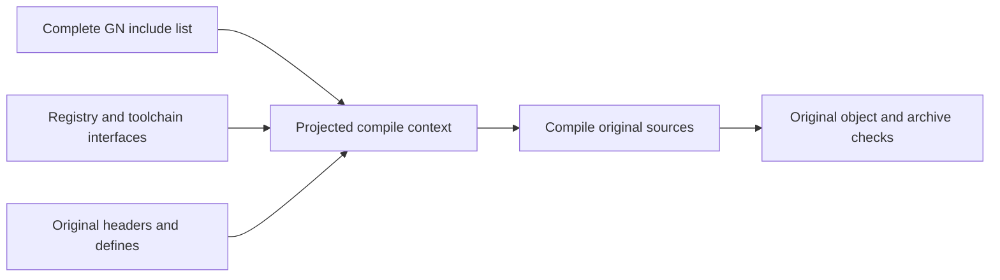

# Include context probe

Clone the original header/define context. Keep the owner's complete GN include
list, registry/toolchain roots and forwarder interfaces. Remove other inherited
Chromium directories. Default builds stay unchanged.

The checked-in GN snapshot has 63 flattened include roots, including dependency
public configs. The legacy library table retained only 14. Using that smaller
list failed on PartitionAlloc's public source root. No missing-directory
exceptions were added; the corrected list comes directly from the snapshot.
`include_context_roots.bzl` records its checksum.

Actual arguments shrink from 941 include paths to 782. All 256 commands preserve
other flags/environments and retained include order. A real sandboxed build
executes 256 compiles; all original objects and archive bytes match. Same trained
LLVM hash. This is correctness proof, not a timing or cold result. Local ABBA
with fresh sandbox directories is pending.

Evidence:

- `/tmp/chromium-include-context-full-roots-preflight.json`
- `/tmp/chromium-include-context-command-proof.json`
- `/tmp/chromium-include-context-full-roots-correctness.json`
- `/tmp/chromium-include-context-abba-001/report.json` when complete

The rejected 14-root attempt is preserved in
`/tmp/chromium-include-context-14-roots-failure.log`.
