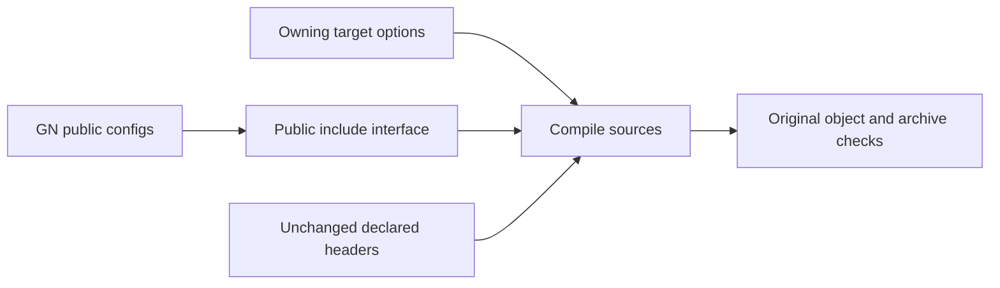

# Include context probe

Keep declared headers, defines, registry/toolchain roots and forwarder interfaces.
Retain the owner's captured GN include roots; remove other inherited Chromium
roots. This isolates public include propagation from header availability.

Actual first-source arguments shrink from 941 include paths to 764. All 256
commands preserve other flags/environments and relative include order. This is
18.81% fewer paths, not a measured build improvement.

Compilation fails before correctness acceptance:

```text
fatal error: 'partition_alloc/pointers/raw_ptr_exclusion.h' file not found
```

The owning GN list lacks PartitionAlloc's public source include root. Upstream
`base/allocator/partition_allocator/src/partition_alloc/BUILD.gn` exports it through
`public_includes`. Current flattened library metadata has no public/private
include distinction. Do not fix this by accumulating missing directories.
Capture and preserve public dependency interfaces before further pruning.



Prototype stays isolated. No default build change or performance claim.
Raw commands: `/tmp/chromium-include-context-preflight.json`.
Failure log: `/tmp/chromium-include-context-256.build.log`.
