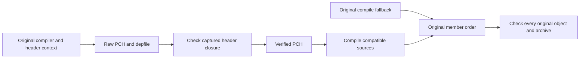

# Declared PCH experiment

Reuse parsed headers through the registered hermetic LLVM toolchain. Keep Clang
validation enabled. Relocatable PCH and prefix mapping preserve original filename
strings. Producer depfiles must match captured project header closures; consumers
declare those headers explicitly. Missing or ambiguous mappings fail.

The larger variant uses document PCH on 116 byte-compatible consumers, string PCH
on 125 others, and original compilation on 15. HTML marquee keeps string PCH;
document PCH reordered its trace sections. Archive member order stays original.

All timing comparisons keep supporting actions warm. Every measured phase runs
256 actual compiles and checks all original objects/archive plus source subprocess
traces. Candidate phases rebuild raw and verified PCH outputs, including closure
validation. Removing only the verified PCH would hide a cached producer.

- Standard PCH on BB: 100.382 s versus 98.334 s mean, 2.04% wall reduction.
- String PCH on BB: 101.804 s versus 95.299 s mean, 6.39% wall and 10.91% compiler
  CPU reduction. Actual runner: 19 CPU AMD EPYC, 35,262,926,848 bytes RAM.
- Larger variant on BB: 100.708 s versus 77.278 s mean, 23.27% wall and 30.99%
  compiler CPU reduction. Baselines 102.030/99.387 s; candidates 77.981/76.576 s.
  Both PCH producers and closure validators rerun each candidate phase.
- Larger variant locally: 58.227 s versus 45.619 s mean, 21.65% wall and 28.55%
  compiler CPU reduction. Baselines 59.111/57.343 s; candidates 45.919/45.318 s.
  16 CPU quota, 48 GiB machine, 6 GiB JVM, 24 GB action budget, private 8 GiB RAM
  sandboxes, directory reuse disabled. Both PCH producers and validators rerun.

The frozen original cohort archive is
`4a346e0ea2f9d63adfe21ceade07f671006b4653476f487c1f92aeac5ee2fb90`.
The controller rejects baseline drift before accepting candidate results.
Default browser builds remain unchanged. Full browser payload, ABI/rendering and
strict-cold gates remain required; these cohort gains do not prove sub-hour cold.

Four real compiler traces retain original objects and spend roughly 93–98% of
compiler trace time in the frontend. Header parsing/instantiation are useful
targets. Inclusive trace subtotals overlap; do not add them. This sample is not a
full-build proportion.

Evidence:

- `/tmp/chromium-source-aware-pch-bb-summary.json`
- `/tmp/chromium-hybrid-pch-bb-summary.json`
- `/tmp/chromium-hybrid-pch-256-correctness.json`
- `/tmp/chromium-hybrid-pch-command-proof.json`
- `/tmp/chromium-hybrid-pch-ram-abba-001/report.json`
- `/tmp/chromium-clang-phase-probe-001/report.json`

The manual full-core probe passes all 2,398 original objects and the complete
archive: 1,374 document PCH, 930 string PCH, 94 original compiles. Fourteen
document imports changed objects; all fourteen preserve original bytes with
string PCH. Candidate membership agrees with all original compiler depfiles. Original component archive
reference, assembled from saved original objects in native order:
`187c9d4d3f119abe2a5c01adda4e47d449d35bef9e08079af1a8136950a020c5`.
Probe targets add two implicit main-repository quote roots; production integration
must preserve the original native repository context.

Full-core evidence: `/tmp/chromium-full-core-pch-final-byte-proof.json`.
Generated bindings: three pinned-compiler traces preserve original objects;
all three also match with a direct `idl_types.h` PCH pilot. No sandboxed full
binding cohort or timing claim yet. That header appears in all 1,030 original
binding depfiles and 1,800 core depfiles.
