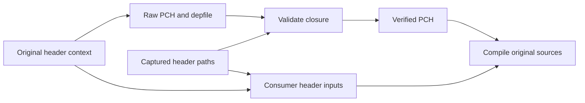

# Project PCH prototype

Direct WTF string PCH matches all eight original objects. No sandboxed cohort,
performance or cold proof yet. The header occurs in all eight original dependency
sets; its captured closure has 140 project headers.

Document PCH is rejected. Restoring relocated filename spelling fixes its string
differences, but it adds empty allocated `protected_memory` sections to a source
that did not originally include them. No section stripping or byte-gate exception.

The next prototype must validate its actual depfile against the captured closure
before publishing its PCH. Resolve captured paths to declared File artifacts;
missing or ambiguous mappings fail. Consumers declare every captured project
header alongside the PCH and managed toolchain files. This keeps hidden PCH
imports visible to Bazel even when its include scanner prunes ordinary inputs.

Keep Clang validation enabled. Use supported relocation and file-prefix mapping
to preserve original filename strings. Require all 256 original object/archive
hashes before timing, then complete browser payload, ABI/rendering and strict
cold gates. The standard-only BB experiment remains separate.

A graph audit finds 100 large captured source groups covering 20,892 inventoried
compile actions. This is potential reach, not compatibility or timing proof.
A production producer must derive defines from existing dependencies rather than
its consumer target, avoiding a dependency cycle. Default builds stay unchanged.

## Sandboxed WTF string result

Prototype now validates the actual depfile before copying its PCH and declares
all 140 resolved project headers on consumers. A real sandboxed build executed
256 compiles, one PCH producer and one closure validator. No supporting compiles
or generators reran. Exactly 255 original objects matched. The remaining
`fullscreen_request_type.pic.o` changed ELF function/section order and local
constant symbol numbering. Archive differs. Reject this header for rollout;
no byte-gate exception. Report: `/tmp/chromium-project-pch-256-correctness.json`.

## Smaller allocator header

`wtf/allocator/allocator.h` passes all 256 original object and archive hashes in
real sandboxes. Captured closure has 68 project headers. Same compiler, one fresh
PCH, one closure check, 256 actual compiles, no supporting rebuilds. Report:
`/tmp/chromium-allocator-pch-256-correctness.json`. Performance remains unmeasured.

Original depfiles show that only 241/256 sources include WTF string, 253 include
allocator, and 117 include `document.h`. Larger PCH experiments should compile
only original consumers with that PCH; other sources retain their original flags.

## Existing-consumer document PCH

Splitting the original cohort into 117 document consumers and 139 unchanged
sources avoids adding document imports. The archive rule restores original
member order. A real build still changes `html_marquee_element.pic.o`: two trace
function sections swap order. Other 255 objects match. Reject document PCH;
no byte-gate exception. Report:
`/tmp/chromium-source-aware-document-pch-256-correctness.json`.

Producer trace also shows 205.53 s in `sandbox.filterInputsAndDirsToCreate`
versus 3.93 s in the compiler. This run proves neither timing benefit nor a
cold-build cause. Investigate sandbox reuse separately with fixed inputs.
