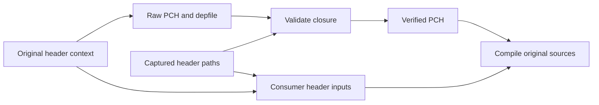

# Project PCH prototype

Direct WTF string PCH matches all eight original objects. No sandboxed cohort,
performance or cold proof yet. The header occurs in all eight original dependency
sets; its captured closure has 140 project headers.

Document PCH is rejected. Restoring relocated filename spelling fixes its string
differences, but it adds empty allocated `protected_memory` sections to a source
that did not originally include them. No section stripping or byte-gate exception.

The next prototype must validate its actual depfile against the captured closure
before publishing its PCH. Resolve captured paths to declared File artifacts;
missing or ambiguous mappings fail. Consumers declare every captured project
header alongside the PCH and managed toolchain files. This keeps hidden PCH
imports visible to Bazel even when its include scanner prunes ordinary inputs.

Keep Clang validation enabled. Use supported relocation and file-prefix mapping
to preserve original filename strings. Require all 256 original object/archive
hashes before timing, then complete browser payload, ABI/rendering and strict
cold gates. The standard-only BB experiment remains separate.

A graph audit finds 100 large captured source groups covering 20,892 inventoried
compile actions. This is potential reach, not compatibility or timing proof.
A production producer must derive defines from existing dependencies rather than
its consumer target, avoiding a dependency cycle. Default builds stay unchanged.
